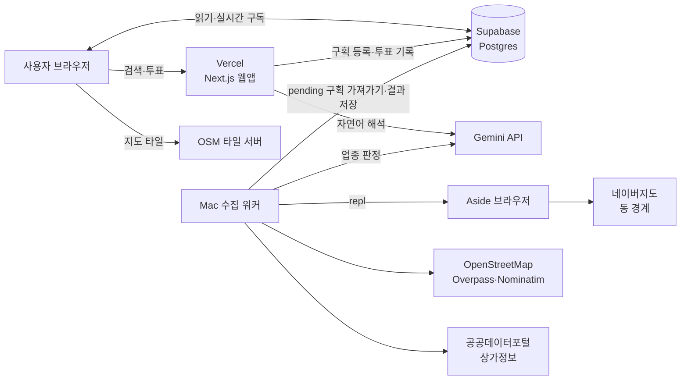
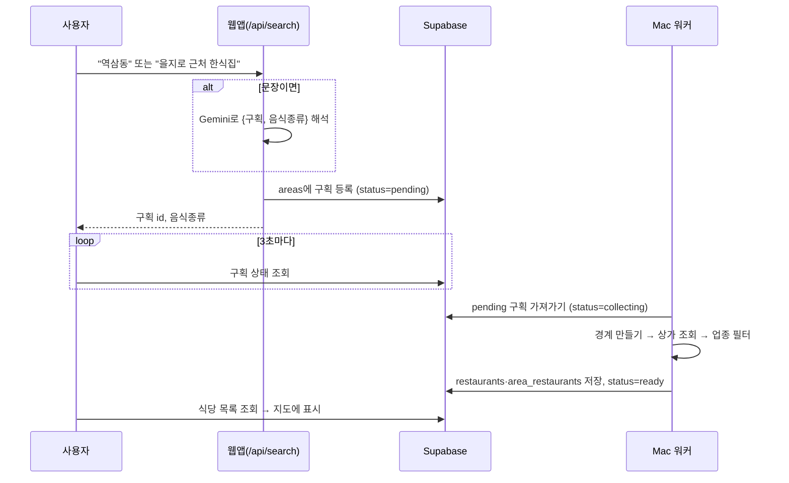
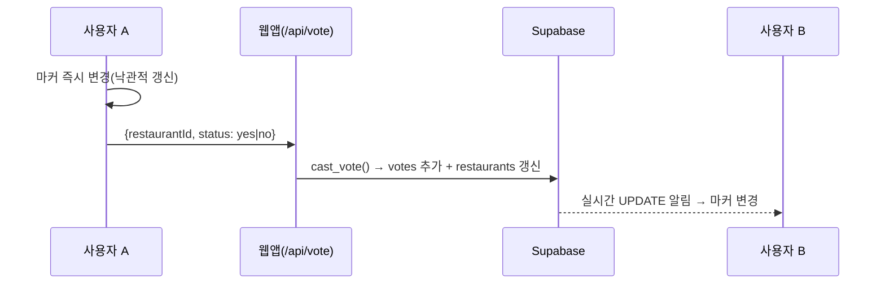
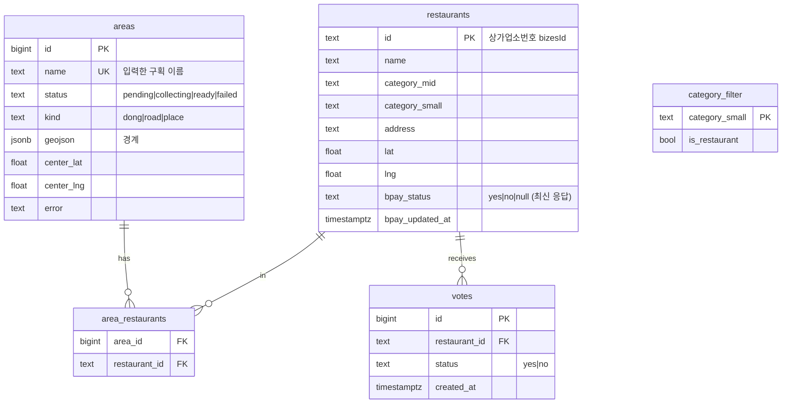

# 아키텍처

## 1. 전체 구성



| 구성 요소 | 위치 | 역할 |
|---|---|---|
| 웹앱 | Vercel | 화면, 검색 API, 투표 API |
| DB | Supabase | 구획·식당·응답 저장, 실시간 변경 알림 |
| 수집 워커 | 내 Mac (`npm run worker`) | 새 구획의 경계와 식당을 수집 |
| Aside | 내 Mac | 네이버지도에서 동 경계를 가져올 때 쓰는 브라우저 |
| Gemini | Google | 자연어 검색 해석(웹), 식당 아닌 업종 판정(워커) |

**Mac에 워커가 따로 있는 이유:** Aside는 내 Mac 안에서만 동작하고, 인터넷에서 부를 수 있는 API가 없습니다. 그래서 웹앱은 DB에 "수집할 구획"만 등록합니다. 그러면 Mac 워커가 그 구획을 가져가 처리합니다.

## 2. 처리 흐름

### 2.1 구획 검색과 수집



- **이미 수집된 구획**은 바로 ready 상태이므로 즉시 지도에 그려집니다.
- **수집에 실패한 구획**은 status가 failed가 됩니다. 같은 이름으로 다시 검색하면 pending으로 돌아가 재시도합니다.
- **워커가 처리 도중 꺼진 경우**, 워커를 다시 시작하면 collecting 상태인 구획을 pending으로 되돌립니다.

### 2.2 구획 경계를 만드는 순서 (`worker/index.ts` `resolveArea`)

| 순서 | 조건 | 방법 | 결과 kind |
|---|---|---|---|
| 1 | 네이버가 경계를 주면 | Aside로 네이버지도 검색 화면을 열고 `/p/api/polygon` 응답을 읽음 | `dong` |
| 2 | 이름이 `로`·`길`로 끝나면 | Overpass로 같은 이름의 도로선 → 2km 안에 이어진 가장 큰 묶음 → 양옆 50m | `road` |
| 3 | 그 밖 | Nominatim으로 위치 → 반경 300m 원 | `place` |

네이버 검색 API는 캡차 토큰을 요구하므로 직접 부르지 않습니다. 브라우저 화면을 열었을 때 지도가 스스로 받아온 경계 데이터만 다시 읽습니다.

### 2.3 식당 수집 (`worker/stores.ts`, `worker/filter.ts`)

1. 경계 폴리곤을 WKT로 바꿔 상가정보 API(`storeListInPolygon`)에 보냅니다. 조건은 음식 업종 `I2`이고, 1000건씩 페이지를 넘기며 가져옵니다. 꼭짓점이 200개를 넘으면 단순화해서 보냅니다.
2. 받은 결과를 원래 폴리곤으로 다시 걸러, 안에 있는 점만 남깁니다.
3. 업종 소분류 이름을 Gemini에 보내 식당인지 판정합니다. 카페·주점·제과 등은 제외되고, 판정 결과는 `category_filter`에 캐시합니다.
4. 식당을 `restaurants`에 upsert합니다. 이때 비플페이 상태 열은 건드리지 않으므로 기존 응답이 유지됩니다.

### 2.4 투표



저장에 실패하면 A의 마커를 원래대로 되돌리고 안내 문구를 보여줍니다.

## 3. 데이터 모델 (`web/supabase/schema.sql`)



- **비플페이 상태**는 식당에 하나만 둡니다. 그래서 같은 식당이 여러 구획(예: 동과 도로 띠)에 속해도 표시가 똑같습니다.
- **권한(RLS):** 익명 사용자는 `areas`, `restaurants`, `area_restaurants`를 읽기만 할 수 있습니다. 쓰기는 서비스 롤 키를 가진 웹 API와 워커만 합니다.
- **실시간 반영:** `restaurants`와 `areas`를 `supabase_realtime`에 등록했습니다.

## 4. 폴더 구조

```
bplepay2222222/
├── 작업절차.md
├── architecture.md
├── .claude/launch.json          로컬 미리보기 설정
└── web/                         Vercel에 배포하는 프로젝트 루트
    ├── README.md                설정·실행 방법
    ├── .env.example             필요한 환경변수 목록
    ├── supabase/schema.sql      DB 스키마
    ├── src/
    │   ├── app/
    │   │   ├── page.tsx             지도 컴포넌트를 브라우저에서만 불러옴
    │   │   ├── layout.tsx
    │   │   ├── globals.css          마커 색·형광 깜빡임 애니메이션
    │   │   └── api/
    │   │       ├── search/route.ts  구획 등록(+Gemini 자연어 해석)
    │   │       └── vote/route.ts    투표 기록
    │   ├── components/MapView.tsx   지도·검색·팝업·실시간 반영
    │   └── lib/
    │       ├── supabase.ts          DB 클라이언트, 타입
    │       └── gemini.ts            Gemini 호출(웹·워커 공용)
    └── worker/                      Mac 수집 워커
        ├── index.ts                 대기열 처리 루프, 구획 판별 순서
        ├── aside.ts                 Aside repl로 네이버 동 경계 가져오기
        ├── osm.ts                   도로 띠·지명 반경 만들기
        ├── stores.ts                공공데이터 상가정보 조회
        ├── filter.ts                Gemini 업종 판정 + 캐시
        └── scripts/try-area.ts      키 없이 구획 판별만 시험
```

## 5. 환경변수

| 변수 | 웹(Vercel) | 워커(Mac) | 용도 |
|---|:-:|:-:|---|
| `NEXT_PUBLIC_SUPABASE_URL` | ✓ | ✓ | Supabase 주소 |
| `NEXT_PUBLIC_SUPABASE_ANON_KEY` | ✓ | | 브라우저 읽기·실시간 구독 |
| `SUPABASE_SERVICE_ROLE_KEY` | ✓ | ✓ | 서버 쓰기 (브라우저에 노출 금지) |
| `GEMINI_API_KEY` | ✓ | ✓ | 자연어 해석, 업종 판정 |
| `GEMINI_MODEL` | 선택 | 선택 | 기본 `gemini-3.6-flash` |
| `DATA_GO_KR_KEY` | | ✓ | 상가정보 API (Decoding 키) |
| `ASIDE_PROFILE` | | 선택 | 사용할 Aside 브라우저 프로필 |

## 6. 지도 표시 규칙

| 상태 | 마커 |
|---|---|
| 확인 안 됨 | 주황 점 |
| 가능 (`yes`) | 주황 점 + 형광(#39ff14) 테두리가 1초 주기로 깜빡임 |
| 불가능 (`no`) | 회색 점 |

자연어 검색에서 음식 종류(예: 한식)가 나오면 업종 중분류·소분류·상호에 그 단어가 들어간 식당만 보여줍니다. 칩의 ✕를 누르면 필터가 풀립니다.

## 7. 제약과 위험

- **새 구획 수집:** Mac이 켜져 있고, 워커가 실행 중이고, Aside에 로그인돼 있어야 합니다.
- **네이버 경계:** 동 이름에서만 받을 수 있습니다. 같은 이름의 동이 여러 곳이면 네이버가 고른 곳을 씁니다.
- **같은 이름의 도로:** 여러 도시에 있으면 가장 길게 이어진 쪽을 고릅니다.
- **OSM 기본 타일 서버:** 트래픽이 많은 서비스에는 쓰지 말라는 정책이 있습니다. 사용자가 늘면 타일 주소를 바꿔야 합니다.
- **로그인 없음:** 누구나 표시를 바꿀 수 있습니다. 모든 응답이 `votes`에 남으므로, 문제가 생기면 이 기록을 보고 되돌립니다.
- **마커 겹침:** 역삼동처럼 식당이 2천 곳이 넘는 구획을 한 화면에 보면 마커가 겹칩니다. 특정 식당을 누르려면 지도를 확대해야 합니다.
